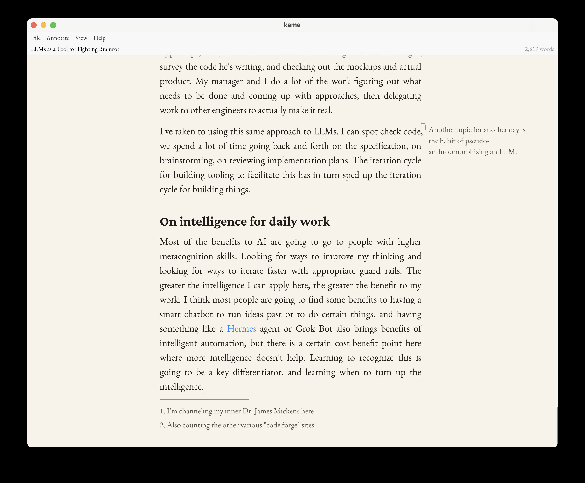

# kame

**Kyle's Marginalia Editor** — a WYSIWYG editor for writing ideas and thinking.

You type into the typeset page; kame renders your prose with real typography
(Crimson Pro headings, EB Garamond body) and lets you write alongside it in
the margin. Markdown and HTML are generated only on export — the document
itself is a structured, first-class file, never a pile of markup.



## Features

- **Anchored marginalia** — notes in the margin that stay with their paragraph.
- **Notes** — highlight a passage, with a comment if you want one.
- **Footnotes** — numbered markers, collected at the foot of the page.
- **Persistent undo** — the edit history lives in the file, so it survives
  closing and reopening, and can be shared.
- **Snapshots** — save a point-in-time copy of the document and restore it
  later.
- **Distraction-free modes** — fullscreen, hide chrome, hide margin, paragraph
  focus, typewriter.
- **Export** — deterministic HTML with footnotes and marginalia, and Markdown with
  footnotes. What a note says is private and never exports.
- **Document properties** — title, author, dates and tags, published with each
  export.
- **Markdown import** — open a `.md` file as a new document; the status line
  says what was simplified.
- **Headings and lists** — `Ctrl-Shift-1/2/3` for H1/H2/H3, `Ctrl-Shift-0` for
  body text, and `- ` or `1. ` at the start of a line for a list.
- **Code and prose blocks** — text kept exactly as typed, line breaks and spacing
  included.
- **Images** — shown on the page, and kept with a notebook wherever it moves.
- **Links between documents** — `[[essay]]` or File > Link to Document, and
  clicking one opens it.
- **Notebooks** — a folder of documents with a jump list, a search and a browser,
  which publishes as its own site.
- **Spelling** — optional marks for likely mistakes, checked offline.
- **Other versions** — merges the conflict copies a sync tool leaves behind.
  Revision logs for syncing a folder between machines are in trial.

## Install

**Homebrew:**

```sh
brew install kisom/tap/kame                      # builds kame and kame-site from source
brew install --cask --no-quarantine kisom/tap/kame   # installs kame.app from the GitHub release
```

The cask is the same app that `make mac-app` builds: ad-hoc signed and not
notarized, for Apple Silicon only, which is why it needs `--no-quarantine`.

**GitHub release:** each [release](https://github.com/kisom/kame/releases) has
`kame.app.zip`, the macOS app, with the same limits as the cask.

**Arch Linux:** `kame` in the AUR, for example `yay -S kame`. It installs
`kame`, `kame-site`, the desktop shortcut and the `.kame` file type.

**From source:** `make install`, below.

## Building

Dependencies: a Rust toolchain (edition 2021) and a C compiler. On Linux you
also need `pkg-config` and the X11/Wayland/Vulkan development libraries — see
[`flake.nix`](flake.nix) for the exact set. NixOS gets all of these through
direnv/`nix develop` (the `.envrc` wires up the flake); macOS and Arch install
them natively.

```sh
make          # debug build
make test     # run the test suite
make install  # release build, install kame, kame-site + a desktop shortcut
make clean    # remove build artifacts
```

Or with cargo directly:

```sh
cargo build
cargo test
```

On NixOS:

```sh
nix develop   # dev shell with cargo/clippy/rustfmt/rust-analyzer
nix build .#  # build the package
nix run .#    # launch the binary
```

On macOS, build an `.app` bundle:

```sh
make mac-app   # builds target/kame.app (ad-hoc signed, for local use)
```

`packaging/macos/build-app.sh` assembles the bundle — the release binary, an
`Info.plist`, and a `kame.icns` icon generated from `packaging/kame.png` —
and ad-hoc signs it. Launch it with `open target/kame.app` (a bare `target/release/kame`
binary runs, but has no menu bar and won't take keyboard focus). Shipping the
app to others needs a Developer ID certificate and `notarytool` notarization.

## Using

```sh
kame                    # the last document, or an empty one; its first save asks for a file
kame <document.kame>    # open (or create) a document
kame <notes.md>         # import Markdown as a new, unsaved document
kame <folder>           # open a notebook
```

`make install` also drops a `kame.desktop` launcher (with an icon) into
`~/.local/share/applications` and registers `.kame` files, so kame can be started
from the desktop or by opening a document. The flake's package does the same. A
`.kame` file is a SQLite database, so on a desktop without its own file-type
handling, such as Hyprland, `xdg-open` also needs the `mimetype` command
(`perl-file-mimeinfo` on Arch) to recognise it rather than treating it as SQLite. Saving
(`Ctrl-S`) on a document with no file opens the system save-as browser; closing
a window with unsaved anonymous text asks before it is lost.

The [user's guide](docs/guide.md) walks through all of it, and key bindings are listed in [docs/keybindings.md](docs/keybindings.md).

## The file format

A `.kame` document is a SQLite database: the current document, an append-only
log of every edit (persistent, shareable undo), and point-in-time snapshots.
The schema is versioned with `PRAGMA user_version`.

## Publishing

`kame-site` builds a static site from `.kame` documents and Markdown pages:

    cargo run -p kame-site -- new mysite
    cd mysite
    # edit site.yaml and theme/templates/index.html
    cargo run -p kame-site -- build
    python3 -m http.server -d output

A new site has a `Makefile` with `build`, `serve`, `clean` and `sync`. Set `UPSTREAM` at its top
for `make sync`, which rsyncs `output/` there and deletes anything else.

`kame-site regen-theme` updates a site's theme from a newer `kame-site`, moving the old one to
`theme.old` so that nothing you edited is lost.

`kame site ...` is the same tool, built into the app. A notebook builds as its own site with
`kame-site build FOLDER`; see [Publishing a notebook](docs/keybindings.md#publishing-a-notebook).

## License

kame's code is licensed under the [Apache License 2.0](LICENSE). The fonts it
embeds are licensed under the SIL Open Font License 1.1; their licenses are in
[`crates/kame-typeset/fonts`](crates/kame-typeset/fonts).
